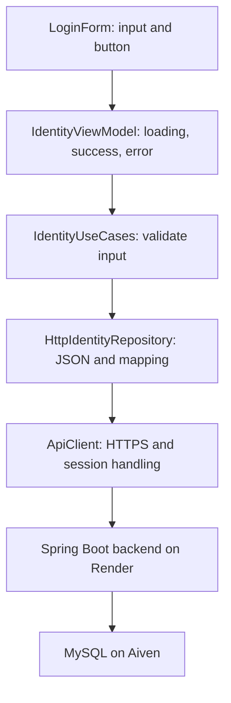

# Understanding SafeWork: structure, Kotlin and request flow

SafeWork is a native Android app written in Kotlin. Jetpack Compose draws its
screens. A separate Spring Boot backend runs on Render and connects to MySQL on
Aiven. The Android app sends HTTPS requests to the backend; it does not connect
directly to MySQL or contain database credentials.

## Start with a single request

When you tap Log in, these are the main steps:



The response travels back through these objects. The ViewModel publishes a new UI
state, and Compose redraws the affected screen. You do not manually redraw each
label after a request.

## Two modules and four layers

Gradle modules are compilation units. This project has two:

| Module | Contains | Purpose |
| --- | --- | --- |
| `business` | Domain and Application | Rules and use cases independent of Android and HTTP |
| `app` | Presentation and Infrastructure | Android screens, ViewModels, HTTP, device location and secure session storage |

`app` depends on `business`. `business` does not import Compose, Android or OkHttp.
This is configured by `implementation(project(":business"))` in app/build.gradle.kts.

The four layers answer different questions:

| Layer | Question | Example |
| --- | --- | --- |
| Domain | What is valid in this business? | EmailAddress, UserProfile, MembershipStatus, repository interfaces |
| Application | What steps make up an operation? | IdentityUseCases.login, CompanyUseCases.request |
| Presentation | What does the user see and do? | IdentityScreen, IdentityViewModel, CompanyScreen |
| Infrastructure | How do we communicate or store data? | HttpIdentityRepository, ApiClient, EncryptedSessionStore |

An interface in Domain describes the operations available to a use case. An HTTP
class in Infrastructure implements that interface. The use case receives the
implementation through its constructor. It can therefore use it without knowing
anything about HTTP.

## Packages group business responsibilities

Inside the modules, packages are grouped into three bounded contexts:

- `iam`: identity and access management, including login, profiles, companies and
  memberships.
- `incidentmanagement`: incident reporting, querying, assignments and transitions.
- `notificationmanagement`: the current recipient's notifications.

`core` contains shared technical code: networking, configuration, navigation and
the design system. It is not a fourth business context.

The most useful files to read first are:

| File | What to look for |
| --- | --- |
| [MainActivity.kt](../app/src/main/java/com/nexorape/safework/MainActivity.kt) | Android entry point; starts Compose and obtains the identity ViewModel |
| [SafeWorkApplication.kt](../app/src/main/java/com/nexorape/safework/SafeWorkApplication.kt) | Creates the application-scoped graph lazily |
| [AppGraph.kt](../app/src/main/java/com/nexorape/safework/core/configuration/AppGraph.kt) | Connects concrete dependencies through constructors |
| [SafeWorkNavigation.kt](../app/src/main/java/com/nexorape/safework/core/navigation/SafeWorkNavigation.kt) | Chooses screens and checks active membership before showing business tabs |
| [IdentityScreen.kt](../app/src/main/java/com/nexorape/safework/iam/presentation/IdentityScreen.kt) | Login, registration and profile UI |
| [IdentityViewModel.kt](../app/src/main/java/com/nexorape/safework/iam/presentation/IdentityViewModel.kt) | UI state and asynchronous identity actions |
| [IdentityUseCases.kt](../business/src/main/kotlin/com/nexorape/safework/iam/application/IdentityUseCases.kt) | Validation and orchestration |
| [IdentityRepository.kt](../business/src/main/kotlin/com/nexorape/safework/iam/domain/repositories/IdentityRepository.kt) | Repository contract and identity failures |
| [HttpIdentityRepository.kt](../app/src/main/java/com/nexorape/safework/iam/infrastructure/http/HttpIdentityRepository.kt) | JSON requests, response validation and session persistence |
| [ApiClient.kt](../app/src/main/java/com/nexorape/safework/core/network/ApiClient.kt) | Network transport, bearer headers and HTTP errors |

Android files here use a directory named `java`, but their `.kt` extension means
they are Kotlin files. That directory name does not make them Java source.

## Kotlin syntax you will repeatedly see

| Syntax | Meaning in this app |
| --- | --- |
| `val` | A reference/property that cannot be reassigned. The object it refers to may still expose mutable state. |
| `var` | A variable/property that can be reassigned. |
| `fun login(email: String)` | Declares a function with a String parameter. |
| `fun ... = expression` | An expression body; Kotlin infers its return type. |
| `class X(private val dependency: Y)` | A constructor parameter also stored as a private property. |
| `data class` | A data model with generated equality and copy support. |
| `enum class` | A fixed set of named values, such as ACTIVE and REVOKED. |
| `UserProfile?` | The value may be a UserProfile or null. |
| `user?.companyId` | Access the property only when user is non-null; otherwise return null. |
| `value ?: fallback` | Use fallback when value is null. |
| `value!!` | Assert non-null; throws if the assertion is wrong. It is not a validation mechanism. |
| `List<CompanySummary>` | A list whose elements have the CompanySummary type. |
| `interface` / `override` | Declare a contract / implement a method from that contract or a superclass. |
| `: ViewModel()` | Inherit from ViewModel and call its constructor. |
| `suspend fun` | A function that may suspend in a coroutine; it does not automatically select a background thread. |
| `viewModelScope.launch { ... }` | Start a coroutine associated with the ViewModel's lifetime. |
| `{ email = it }` | A lambda; `it` is its single implicit parameter. |
| `viewModel::login` | A reference to a function, passed as a callback. It is not a call to login yet. |
| `mapOf("email" to email.value)` | Create a map. `to` creates a key/value pair. |
| `"${company.value}"` | Insert an expression into a string. |
| `require(condition)` | Reject invalid input by throwing IllegalArgumentException when false. |
| `when` | Choose a branch based on a value or conditions. |
| `.copy(busy = true)` | Create a new data-class instance with that property changed. |

For example, the actual use case starts like this:

```kotlin
class IdentityUseCases(private val repository: IdentityRepository) {
    suspend fun login(email: String, password: String) = validated {
        repository.login(EmailAddress.of(email), Password.forLogin(password))
    }
}
```

Read it in this order: create an IdentityUseCases object with a repository;
receive text from the UI; convert that text into validated domain values; invoke
the repository. The `validated` helper turns invalid input into an IdentityException
that Presentation knows how to display.

The app also uses value classes such as UserId and CompanyId. Both contain a Long,
but having different types prevents accidentally passing a user ID where a company
ID is required.

## How Compose inputs work

This is a shortened example from the login screen:

```kotlin
var email by remember(state.emailHint) { mutableStateOf(state.emailHint) }
var password by remember { mutableStateOf("") }

SafeWorkPrimaryButton(
    text = stringResource(R.string.iam_login),
    onClick = {
        actions.login(email, password)
        password = ""
    },
    enabled = !state.busy,
)
```

- `@Composable` identifies functions that participate in drawing Compose UI.
- `mutableStateOf` creates observable UI state.
- `remember` keeps it across recompositions of that screen. It does not persist a
  password after process death or act as permanent storage.
- `by` delegates reads/writes to the state object's value.
- The lambda passed to onClick runs when the user presses the button.
- Clearing password after submission removes it from the input field; the operation
  already received the submitted String.
- `!state.busy` means the button is enabled only while no operation is in progress.
- `stringResource` reads localized text. English resources are in `res/values` and
  Latin American Spanish resources are in `res/values-b+es+419`.

## ViewModels and observable state

IdentityUiState is a data class containing screen, user, busy, error, notice and
emailHint. IdentityViewModel keeps a private MutableStateFlow and exposes a read-only
StateFlow. The screen collects it with collectAsStateWithLifecycle.

For each operation, the ViewModel sets busy, launches a coroutine, invokes a use
case, then publishes success or failure. HTTP repositories use Dispatchers.IO and
the asynchronous OkHttp transport; a suspending call is not a blocking wait on the
Android UI thread.

The `generation` variable protects against a late response restoring an old screen
after the session was invalidated. Company and incident ViewModels also discard
protected results after invalidation. This matters when membership is revoked while
a request is in flight.

## AppGraph is the wiring

These are the essential lines:

```kotlin
val sessions = EncryptedSessionStore(context.applicationContext)
val api = ApiClient(BuildConfig.API_URL, BuildConfig.DEBUG, sessions)
val identity = IdentityUseCases(HttpIdentityRepository(api, sessions))
```

There is no dependency-injection framework to learn here. AppGraph explicitly
constructs the concrete objects and passes them to their consumers. MainActivity
creates the ViewModel using `graph.identity`. Company and other feature objects
are similarly constructed by their navigation factories.

## JSON, authentication and errors

Registration sends exactly:

```json
{
  "fullName": "Example Worker",
  "emailAddress": "worker@example.test",
  "password": "a privately chosen password"
}
```

Login uses `email`, rather than `emailAddress`, plus `password`. Those field names
come from the backend contract and must match exactly.

The login response contains a token. Before saving it, the repository requests
`GET /api/v1/users/me` to obtain and validate the authoritative profile. Subsequent
protected requests use an Authorization header with `Bearer <token>`.

EncryptedSessionStore uses Android Keystore and AES-GCM to protect the stored
credential. It binds the credential to its API URL. Switching a build from localhost
to Render therefore requires signing in against Render; a local session cannot be
reused for the public service.

401 invalidates the local session and returns the user to login. 403 means the
operation is forbidden. A 409 is a conflict, but its context matters: a confirmed
EMAIL_UNAVAILABLE is a duplicate-email response; STATE_CONFLICT during signup is
not proof that the email exists. The client now distinguishes those cases and
does not display arbitrary backend messages.

## Company membership drives access

| State | What the account can do |
| --- | --- |
| UNASSIGNED | Log in, edit profile, create a company or request admission |
| Request PENDING | Keep using profile while awaiting a decision; no company incidents or notifications |
| ACTIVE + WORKER | Use company incidents and notifications |
| ACTIVE + EMPLOYER | Also decide requests and manage worker access |
| REVOKED | Log in for profile and request reentry only to the original company |

PENDING is a request status, not a UserProfile membershipStatus. A pending applicant
may still have UNASSIGNED or REVOKED membership status.

Creating a company makes its creator an EMPLOYER. Accepting a request grants WORKER
membership. Both operations revoke old sessions, so the affected account must log
in again. The backend enforces permissions on every business operation; hiding a
button in Android is only a UI convenience.

## Choosing Render or local development

The public URL is in gradle.properties:

```properties
safework.apiUrl=https://safework-backend-q6id.onrender.com/
```

app/build.gradle.kts copies the selected URL into BuildConfig.API_URL when building
the APK. A temporary `-Psafework.localApiUrl=http://127.0.0.1:18090/` overrides debug
builds only. A localhost build on a USB phone requires adb reverse; a Render build
uses the phone's internet connection and needs no laptop backend.

Installing a different APK is necessary to change that compiled URL. Merely editing
gradle.properties does not change an APK already installed on a phone.

## What the deployed test currently proves

On 2026-11-14, an early deployed registration returned 409 STATE_CONFLICT. Inspection
of the selected Aiven schema later confirmed that users.fk_company_id and
user_sessions.company_id both required non-null values. These constraints conflict
with the new account model, which permits an account and session without a company.
The user corrected both columns to allow null and verified their definitions.

These read-only checks were used to inspect the schema:

```sql
SELECT DATABASE();
SHOW COLUMNS FROM users LIKE 'fk_company_id';
SHOW COLUMNS FROM user_sessions LIKE 'company_id';
SHOW TABLES LIKE 'flyway_schema_history';
```

The schema contained newer membership structures but no Flyway history table.
Reconciling the complete schema, legacy data and migration history remains separate
backend work; do not blindly run the legacy migration against those existing tables.
A successful /health response alone does not prove full schema compatibility.

The Render-configured APK was installed and launched on the Huawei P20 Pro. After
one temporary connection error, the phone browser displayed status UP and the user
successfully retried registration, then confirmed successful sign-in. The user later
reported that the app worked correctly. The exact cause of the temporary connection
error was not established. Automated approval/revocation and incident/notification
coverage comes from the isolated local suite, not an exhaustive production UI run.
